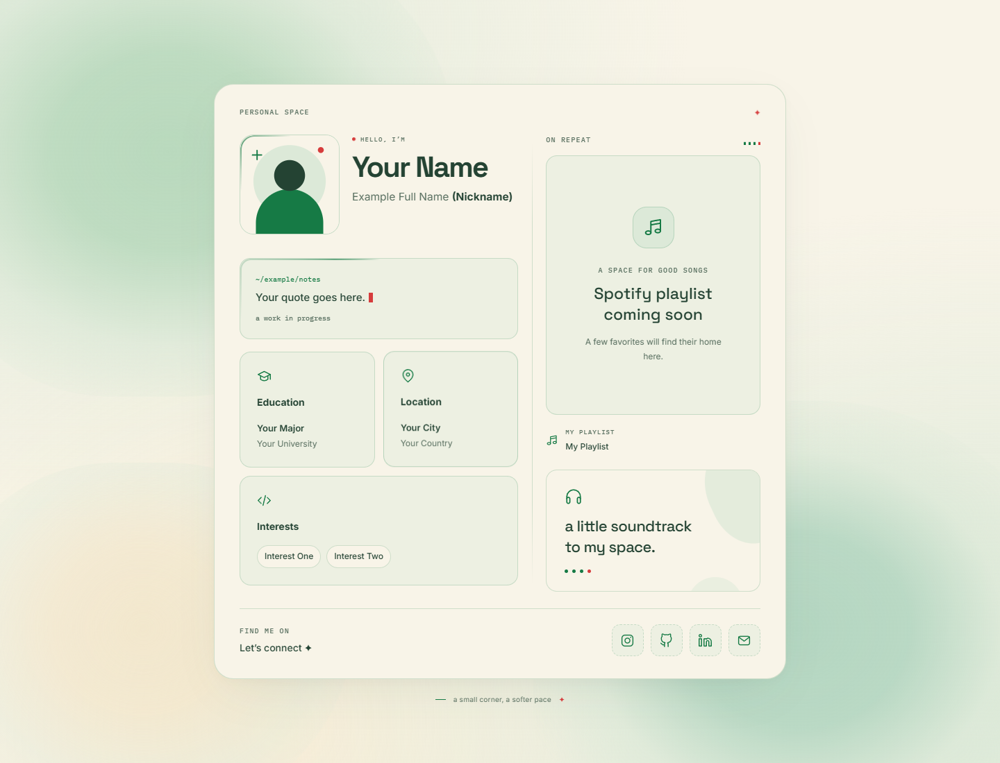

# Astro Personal Portfolio Template

A cozy personal portfolio built with Astro, Tailwind CSS, and TypeScript. The cream-and-green design includes a welcome screen, illustrated avatar with a photo lightbox, terminal quote, education and interest cards, social icons, and an optional Spotify playlist.

Personalize the content primarily through **[src/data/site.ts](src/data/site.ts)**. The default content is fictional and generic; no personal photos, contact destinations, or audio recordings are included.

## Preview



[View the mobile preview](docs/preview-mobile.png).

## Technology

| Technology | Purpose |
| --- | --- |
| Astro 7.3.8 | Static pages and components |
| Tailwind CSS 4.3.3 | Utility styling through the Vite plugin |
| TypeScript 5.9 | Typed configuration and browser interactions |
| Spotify Embed | Optional official playlist browsing and playback |
| Self-hosted fonts | Space Grotesk, Inter, IBM Plex Mono |

No backend, Spotify API credentials, or environment variables are required. Node.js **22.12.0 or newer** and npm are required.

## Install and run

Download or clone your own copy of the repository, open a terminal in its root, and run:

```sh
npm ci
npm run dev
```

Open the URL printed in the terminal, normally `http://localhost:4321`.

| Command | Purpose |
| --- | --- |
| `npm run dev` | Local development with automatic updates |
| `npm run check` | Astro and TypeScript validation |
| `npm test` | Photo lightbox lifecycle and Spotify URL tests |
| `npm run build` | Create the production site in `dist/` |
| `npm run preview` | Preview the production build |

## Personalize your portfolio

Edit [src/data/site.ts](src/data/site.ts), then rebuild when deploying.

| Configuration | Content |
| --- | --- |
| `site.name` | Display name |
| `site.subtitle` | Full name |
| `site.tagline` | Nickname, shown in parentheses |
| `site.photo`, `photoFull`, `photoAlt` | Photo paths and accessible description |
| `site.quote` | Terminal path, quote, and footer |
| `site.information` | Education, location, and interest cards |
| `site.contacts` | Social and email destinations |
| `site.music` | Spotify playlist URL, name, and decorative note |
| `site.seo` | Page title, description, and canonical site URL |

### Profile photo

The default image is a generic SVG avatar at `public/images/avatar.svg`. The lightbox works with this avatar.

To use your own photo, put it in `public/images/my-profile.webp`, set `site.photo` to `/images/my-profile.webp`, and update `photoAlt`. Paths in the configuration omit `public`. Leave `photoFull` empty to reuse the thumbnail, or point it to a separate full-resolution image that loads only when the viewer opens. Missing files fall back to a neutral avatar state.

Custom images are ignored by default to prevent accidental publication. If you intend to distribute your photo, review its content and metadata, then add an explicit exception such as `!/public/images/my-profile.webp` to `.gitignore`. Gitignore does not prevent Astro from copying a file in `public/` into `dist/`; inspect local build output before deploying.

### Education, location, and interests

Edit each entry in `site.information`: `primary` holds the main text, `secondary` holds supporting text, and `badges` supplies interests. Keep the IDs and icons unless you are deliberately adding new card types.

### Social links

The Instagram, GitHub, LinkedIn, and Email destinations start as `null`. Unconfigured icons are safely disabled, without a fake clickable button or invalid link.

Use a full HTTPS URL for a social profile. For email, use a `mailto:` address, for example `mailto:hello@example.com`. Set a destination back to `null` or an empty string to disable it. Supported platforms also include Discord and LINE. External links open in a new tab with `noopener noreferrer`.

### Spotify playlist

Paste the sharing URL for your public Spotify **playlist** into `site.music.playlistUrl`, and edit `playlistName` and `tagline`. Leave the URL empty for the polished coming-soon placeholder.

Only HTTPS playlist links on `open.spotify.com` with a 22-character alphanumeric playlist ID are accepted. Sharing query parameters and locale prefixes are supported. Album, artist, track, URI, and arbitrary external iframe URLs are rejected. The component constructs its own canonical embed and external link URLs.

The official 352px iframe renders Spotify's artwork, track list, attribution, and playback controls. The site does not autoplay or simulate playback. Spotify determines availability and preview/full-song playback based on account, region, browser, and content restrictions. See [official embed documentation](https://developer.spotify.com/documentation/embeds/tutorials/creating-an-embed) and [playback troubleshooting](https://developer.spotify.com/documentation/embeds/tutorials/troubleshooting).

Do not add MP3 files; this integration does not need them.

## Deploy your own copy to Vercel

1. Review your content, assets, and license before publishing your repository.
2. Import your repository as a **new** project in Vercel; keep any existing personal deployment separate.
3. Use the Astro framework preset, the repository root as the root directory, `npm run build` as the build command, and `dist` as the output directory. Select a Node.js version satisfying `package.json`.
4. Grant the Vercel GitHub App access to your repository if using a private repository. Private organization repositories may require a paid Vercel plan; check [Vercel's current Git documentation](https://vercel.com/docs/git).
5. Deploy, then set `site.seo.url` to your production origin and rebuild for a canonical URL.

No environment variables or server adapter are needed. For another static host, deploy `dist/`. If hosting below a subdirectory, configure Astro's `base` in `astro.config.mjs`; local asset helpers honor that base path.

## Accessibility and motion

- Semantic headings, descriptive image text, visible keyboard focus, and a titled Spotify iframe.
- Native photo dialog with Escape/backdrop dismissal, scroll locking, and focus restoration.
- A cream, forest-green, sage, signature-green, and red palette; responsive stacking and flexible track embed width.
- Welcome entrance, blinking cursor, floating background blobs, mouse parallax, and card hover effects.
- Music section fade (300ms), decorative dot pulse (5 seconds), and note-card border emphasis (200ms).
- `prefers-reduced-motion` disables nonessential local animations. The site does not modify animations inside Spotify's iframe.

## Independent maintenance

Keep a personal portfolio and this template in separate directories with separate Git histories and remotes. Never copy `.git`, credentials, personal configuration, or personal media between them.

To port a shared UI improvement manually, start with a clean template branch, copy only the reviewed component/style changes, retain the template's generic `src/data/site.ts`, and review every diff. If using a patch, exclude personal data and assets before applying it. Run checks, tests, a production build, and a privacy scan of source and output before publishing. Do not automatically merge personal commits into the template.

After publishing an approved repository, its owner can enable **Settings → General → Template repository** on GitHub. This lets others create independent repositories from the template rather than inheriting unrelated history.

## Assets and licensing

See [ATTRIBUTIONS.md](ATTRIBUTIONS.md) for fonts, icons, and existing third-party license notices. No project-wide license is selected. Choose one explicitly before advertising this as an open-source template; making a repository public alone does not grant an open-source license.
